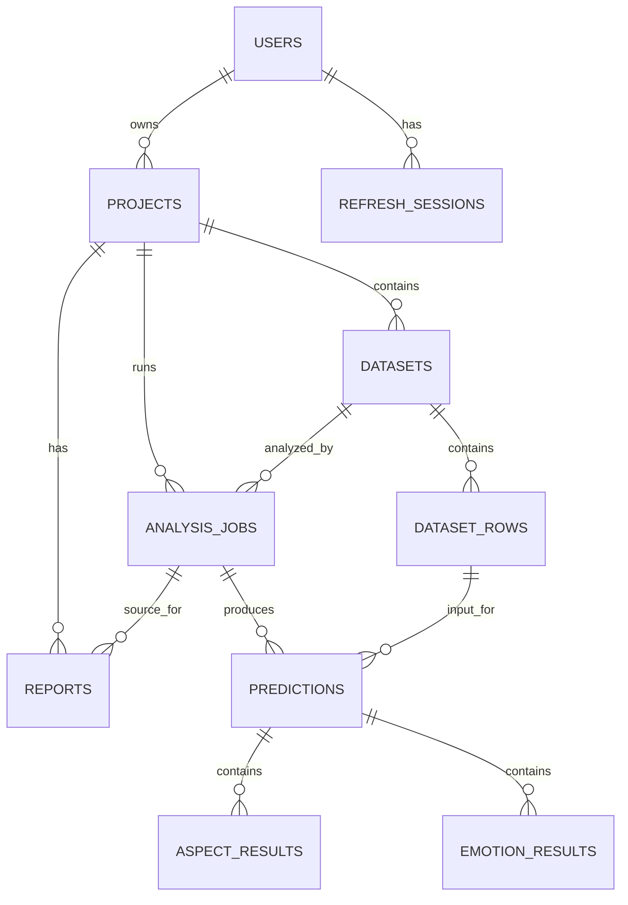

# SentimentIQ database design proposal

> **Status: PROPOSED - NOT IMPLEMENTED.** This document describes a candidate schema only. No SQLAlchemy models, Alembic configuration, migrations, or database tables are defined by this proposal. Review the open decisions before implementation.

## Scope and current backend

The backend currently consists of a FastAPI application in `backend/app/main.py` and SQLAlchemy connection/session setup in `backend/app/database.py`. The API provides `GET /health` and `GET /health/db`. PostgreSQL is configured as a Docker Compose service. No ORM models, Alembic configuration, or migrations exist yet.

This proposal covers nine baseline tables and one optional table. It does not define the ML implementation. The platform backend should call the agreed Person 1 interface and persist its outputs; it must not reimplement or modify ML internals.

## Proposed schema

Use UUID primary keys and timezone-aware `TIMESTAMPTZ` timestamps consistently. Decide whether UUIDs are generated in Python or by PostgreSQL before creating the first migration.

| Table | Purpose and important columns | Relationships, constraints, and indexes |
| --- | --- | --- |
| `users` | Account identity: `id UUID PK`, `email VARCHAR(320)`, `password_hash TEXT`, `is_active BOOLEAN`, `created_at TIMESTAMPTZ`, `updated_at TIMESTAMPTZ`. Store a password hash only if the chosen authentication method uses passwords; never store the original password. | One user owns many projects and has many refresh sessions. Require email. Enforce case-insensitive email uniqueness, for example with a unique index on `lower(email)`. |
| `projects` | Ownership boundary and product/campus domain: `id UUID PK`, `owner_user_id UUID`, `name TEXT`, `domain VARCHAR`, `created_at TIMESTAMPTZ`, `updated_at TIMESTAMPTZ`. | `owner_user_id -> users.id ON DELETE CASCADE`. Require a supported domain such as `product` or `campus` with a `CHECK` constraint after the domain vocabulary is agreed. Index `(owner_user_id, created_at)`. A unique `(owner_user_id, name)` is optional if names must be unique per user. |
| `datasets` | Imported dataset metadata: `id UUID PK`, `project_id UUID`, `name TEXT`, `source_type VARCHAR`, optional `source_filename TEXT`, `created_at TIMESTAMPTZ`. | `project_id -> projects.id ON DELETE CASCADE`. A dataset has many rows and can have many analysis jobs. Index `(project_id, created_at)`. Avoid storing a row count unless it is maintained transactionally; otherwise it can become stale. |
| `dataset_rows` | Input records: `id UUID PK`, `dataset_id UUID`, `row_number INTEGER`, `text TEXT`, optional `external_ref TEXT`, optional `metadata JSONB`. | `dataset_id -> datasets.id ON DELETE CASCADE`. Require nonempty text if agreed. Unique `(dataset_id, row_number)`; index `(dataset_id, row_number)` for ordered reads. |
| `analysis_jobs` | One analysis run over a dataset: `id UUID PK`, `project_id UUID`, `dataset_id UUID`, `domain VARCHAR`, `status VARCHAR`, `model_id TEXT`, `model_revision TEXT`, `created_at TIMESTAMPTZ`, optional `started_at TIMESTAMPTZ`, `finished_at TIMESTAMPTZ`, and non-sensitive `error_code`. | Project and dataset foreign keys cascade on deletion. Constrain status to agreed values such as `pending`, `running`, `succeeded`, `failed`, and `cancelled`. Index `(project_id, created_at)`, `(status, created_at)` for worker lookup, and `dataset_id`. Store the model identifier and revision as a snapshot for each run. |
| `predictions` | Overall sentiment output for one row in one job: `id UUID PK`, `analysis_job_id UUID`, `dataset_row_id UUID`, `sentiment_label VARCHAR`, optional `sentiment_score`, `confidence_value NUMERIC(12,8)`, `confidence_kind VARCHAR`, `created_at TIMESTAMPTZ`. | `analysis_job_id -> analysis_jobs.id ON DELETE CASCADE`; `dataset_row_id -> dataset_rows.id ON DELETE CASCADE`. Unique `(analysis_job_id, dataset_row_id)` if a job produces one overall prediction per input row. Index both foreign keys. |
| `aspect_results` | Aspect-specific outputs: `id UUID PK`, `prediction_id UUID`, `aspect_key TEXT`, optional `sentiment_label VARCHAR`, optional `sentiment_score`, `confidence_value NUMERIC(12,8)`, `confidence_kind VARCHAR`, optional `start_offset INTEGER` and `end_offset INTEGER`. | `prediction_id -> predictions.id ON DELETE CASCADE`. Index `(prediction_id, aspect_key)`. If offsets are included, require both to be null or `start_offset >= 0` and `end_offset > start_offset`. Uniqueness depends on whether the model can return repeated mentions of the same aspect in one text. |
| `reports` | Saved report for a project, optionally tied to one job: `id UUID PK`, `project_id UUID`, optional `analysis_job_id UUID`, `title TEXT`, `created_at TIMESTAMPTZ`, optional `parameters JSONB` and `content JSONB`. | Project and job foreign keys cascade on deletion. Index `(project_id, created_at)` and `analysis_job_id`. Report format and whether report content belongs in PostgreSQL remain open decisions. |
| `refresh_sessions` | Revocable authentication sessions: `id UUID PK`, `user_id UUID`, `token_hash BYTEA`, `created_at TIMESTAMPTZ`, `expires_at TIMESTAMPTZ`, optional `revoked_at TIMESTAMPTZ`. Store only a hash of a refresh token, never the reusable token. | `user_id -> users.id ON DELETE CASCADE`. Require `expires_at > created_at`; make `token_hash` unique. Index `(user_id, expires_at)` for session lookup and cleanup. |
| `emotion_results` *(optional)* | Deferred multi-label emotion outputs: `id UUID PK`, `prediction_id UUID`, `emotion_label VARCHAR`, `confidence_value NUMERIC(12,8)`, `confidence_kind VARCHAR`. | `prediction_id -> predictions.id ON DELETE CASCADE`. If one result per emotion per prediction, unique `(prediction_id, emotion_label)` and index `prediction_id`. Add only after the interface and product use case require it. |

### Relationships



`EMOTION_RESULTS` is optional. A report may be associated with a job; its lifecycle and content format still need agreement.

## Ownership, authorization, and deletion

- **Directly user-owned:** projects and refresh sessions. Datasets, rows, jobs, predictions, aspects, emotions, and reports are owned through their project.
- **Authorization:** derive the user from the authenticated request, then filter project-scoped reads and writes by `projects.owner_user_id`. Never trust a caller-supplied `owner_user_id`. Apply the check to background-job access and report downloads too.
- **Database constraints:** foreign keys protect referential integrity but do not replace API authorization. Consider composite constraints if needed to ensure a job, dataset, and row all belong to the same project/dataset.
- **Project deletion:** cascading from project to datasets/jobs/reports, then from those records to rows and results, gives a consistent full-project deletion policy.
- **User deletion:** the proposed `users -> projects ON DELETE CASCADE` policy deletes that user's projects and dependent data, as well as refresh sessions. This is consequential and irreversible; confirm it before the first migration. If retention or anonymization is required, revise the deletion policy.
- Cascades should be a deliberate application operation in a transaction. Large datasets may require a separately planned deletion strategy.

## Predictions, confidence, and reproducibility

Keep `dataset_rows` separate from `predictions`. A row is source input; a prediction is the output of a particular job. This preserves inputs when a dataset is analyzed again and traces results to a run. `UNIQUE(analysis_job_id, dataset_row_id)` prevents duplicate overall predictions for the same row in one job.

Represent overall sentiment in `predictions` as a categorical `sentiment_label`, with a separate optional numeric score only if Person 1 defines its meaning and scale. Represent aspect sentiment in separate `aspect_results`, each linked to its overall prediction and carrying its own aspect label and sentiment output. Do not assume sentiment labels, score ranges, or text-offset conventions before agreement.

A model confidence value is **not necessarily a true probability**. Store its numeric value with a `confidence_kind`, such as `raw_score` or `calibrated_probability`. Constrain it to `[0, 1]` only when its kind is explicitly a probability. Do not name a generic confidence field `probability`.

Store `model_id` and `model_revision` on `analysis_jobs` as an immutable record of the version used for the run. This assumes one model version per job. If a job can mix versions, the version fields may also need to be stored per prediction.

## Transaction guidance

- Create a dataset and its rows together, so an interrupted import does not leave a misleading partial dataset.
- Create an analysis job and commit its initial status **before** invoking ML. Do not hold a database transaction open during a long-running model call.
- Persist a prediction and its aspect/emotion rows together.
- Update final job status and completion timestamps with the final result persistence step.
- Create a report and its job association together.
- Rotate or revoke refresh sessions atomically so token state cannot be partially updated.
- Apply project/user deletion and its cascades as a deliberate unit of work.

## Person 1 review required before the first migration

The proposed `predictions` and `aspect_results` schema **must be reviewed by Person 1 before the first migration**. Person 1 owns model implementation and analytics computation; the platform backend should call the agreed interface and persist its outputs, not implement or alter ML internals.

The integration interface to agree is:

```python
def analyze(text: str, domain: Literal["product", "campus"]) -> AnalysisResult: ...
def analyze_batch(texts: list[str], domain: str) -> list[AnalysisResult]: ...
def compute_analytics(results: list[StoredResult]) -> AnalyticsSummary: ...
```

Review these schema decisions with Person 1:

1. Exact `AnalysisResult` fields and which are stable relational columns versus optional structured output.
2. Overall sentiment labels and whether a polarity score exists, including its units and range.
3. Aspect identity, repeated aspect mentions, aspect-level sentiment shape, and whether character offsets exist. If so, define the indexing convention.
4. Overall and aspect confidence semantics: raw score, calibrated probability, or another kind; range and calibration guarantees.
5. Whether emotion results will be produced and used soon enough to include the optional table.
6. Whether one job always uses one model ID/revision and the exact values that identify each.
7. Whether batch analysis can return partial results or per-row errors; this affects prediction constraints and job status handling.
8. Which fields `StoredResult` needs for `compute_analytics`, so persisted records suffice without duplicating or reimplementing ML computation in the platform backend.

## Recommended implementation sequence

1. Agree on the Person 1 result contract and the open decisions above.
2. Confirm ownership, account/project deletion, report-retention, and authentication-session policies.
3. Define SQLAlchemy models and shared enum/check-constraint vocabularies.
4. Add Alembic configuration and generate the initial migration from the reviewed models.
5. Review the migration, then apply it to a development database.
6. Implement repository/service operations with scoped authorization and transaction boundaries.
7. Connect the API to Person 1's agreed interface without changing its implementation.
8. Add tests for constraints, ownership isolation, deletion behavior, and result persistence.

## Repository gaps and inconsistencies

- `README.md` says database configuration, models, and migrations will be added later. Database configuration now exists in `backend/app/database.py`; models and migrations remain absent, so that statement is partly outdated.
- `docs/architecture.md` still describes PostgreSQL as planned and says persistence definitions will be introduced later. The Compose service and connection code now exist, but no schema has been created.
- The repository does not document the Person 1/Person 2 integration contract or the shape of `AnalysisResult`, `StoredResult`, or `AnalyticsSummary`.
- Requirements do not define allowed domain values, sentiment labels, score semantics, dataset import formats, project sharing, report structure/retention, or account-deletion policy. These are decisions to agree on, not assumptions for the first migration.
